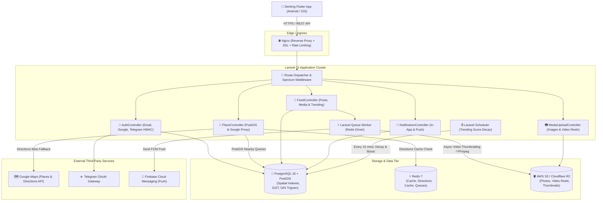
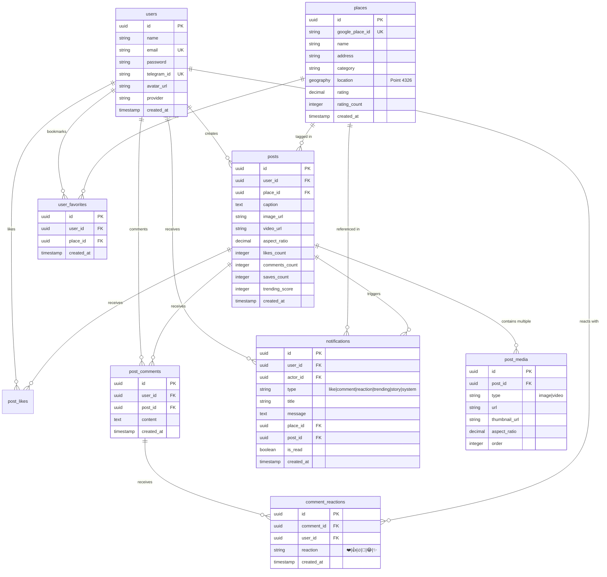
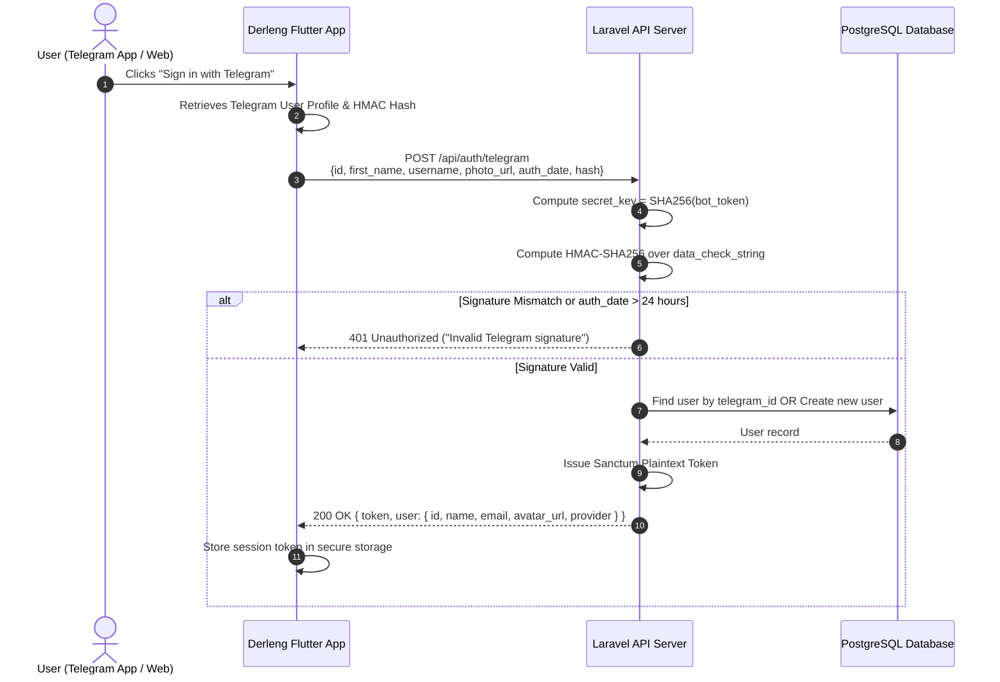
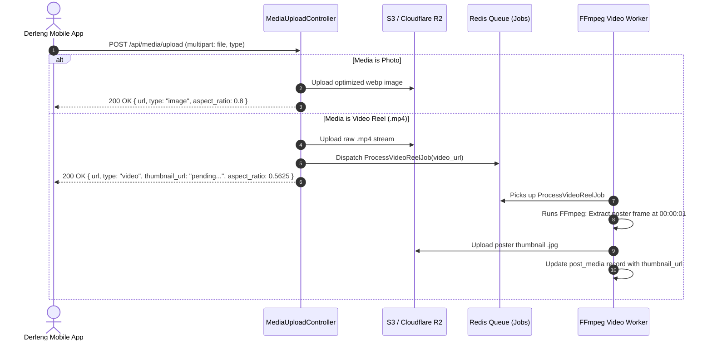

# Derleng Backend Architecture & API Flow Specification

**Tech Stack:** Laravel 11 (PHP 8.2+) · PostgreSQL 16 with PostGIS · Redis · Laravel Sanctum

This document provides the complete, production-ready backend architecture for the **Derleng** travel and social discovery platform. It covers the PostgreSQL schema with PostGIS spatial indexing, complete Laravel migrations, Eloquent models, controllers, authentication flow (including Telegram bot HMAC validation), notification triggers, media upload pipelines, and Docker deployment setup.

---

## 1. System Architecture & Topology



---

## 2. PostgreSQL + PostGIS Database Architecture

### 2.1 Spatial Capabilities

- **Extension:** `postgis` & `pg_trgm`
- **Location Column:** `GEOGRAPHY(Point, 4326)` for WGS84 coordinates.
- **Index:** `GiST` spatial index for millisecond radial searches (`ST_DWithin`) and distance sorting (`ST_Distance`).
- **Trigram Search:** GIN index on place names and addresses for instant fuzzy matching.



---

## 3. Database Migrations (Laravel 11)

### Migration 1: Enable PostGIS & Trigram Extensions

`database/migrations/2026_01_01_000000_enable_postgis_and_trigram_extensions.php`

```php
<?php

use Illuminate\Database\Migrations\Migration;
use Illuminate\Support\Facades\DB;

return new class extends Migration
{
    public function up(): void
    {
        DB::statement('CREATE EXTENSION IF NOT EXISTS "uuid-ossp";');
        DB::statement('CREATE EXTENSION IF NOT EXISTS postgis;');
        DB::statement('CREATE EXTENSION IF NOT EXISTS pg_trgm;');
    }

    public function down(): void
    {
        DB::statement('DROP EXTENSION IF EXISTS pg_trgm;');
        DB::statement('DROP EXTENSION IF EXISTS postgis;');
    }
};
```

### Migration 2: Users Table

`database/migrations/2026_01_01_000001_create_users_table.php`

```php
<?php

use Illuminate\Database\Migrations\Migration;
use Illuminate\Database\Schema\Blueprint;
use Illuminate\Support\Facades\Schema;

return new class extends Migration
{
    public function up(): void
    {
        Schema::create('users', function (Blueprint $table) {
            $table->uuid('id')->primary();
            $table->string('name');
            $table->string('email')->unique();
            $table->string('password')->nullable();
            $table->string('telegram_id')->nullable()->unique()->index();
            $table->string('telegram_username')->nullable();
            $table->string('avatar_url')->nullable();
            $table->string('provider')->default('password'); // password, telegram, google
            $table->string('fcm_token')->nullable();
            $table->rememberToken();
            $table->timestamps();
        });
    }

    public function down(): void
    {
        Schema::dropIfExists('users');
    }
};
```

### Migration 3: Places Table with PostGIS Geography

`database/migrations/2026_01_01_000002_create_places_table.php`

```php
<?php

use Illuminate\Database\Migrations\Migration;
use Illuminate\Database\Schema\Blueprint;
use Illuminate\Support\Facades\DB;
use Illuminate\Support\Facades\Schema;

return new class extends Migration
{
    public function up(): void
    {
        Schema::create('places', function (Blueprint $table) {
            $table->uuid('id')->primary();
            $table->string('google_place_id')->nullable()->unique()->index();
            $table->string('name')->index();
            $table->string('address');
            $table->string('category')->nullable()->index(); // temple, cafe, market, restaurant, hotel
            $table->decimal('rating', 3, 2)->default(0.00);
            $table->unsignedInteger('rating_count')->default(0);
            $table->jsonb('extra_metadata')->nullable();
            $table->timestamps();
        });

        // Add PostGIS Point column (SRID 4326: WGS 84 GPS Lat/Lng)
        DB::statement('ALTER TABLE places ADD COLUMN location geography(Point, 4326);');

        // Create GiST Spatial Index for lightning-fast radius calculations
        DB::statement('CREATE INDEX places_location_gist ON places USING GIST (location);');

        // Create GIN Trigram index for fuzzy text search
        DB::statement('CREATE INDEX places_name_trgm_idx ON places USING GIN (name gin_trgm_ops);');
        DB::statement('CREATE INDEX places_address_trgm_idx ON places USING GIN (address gin_trgm_ops);');
    }

    public function down(): void
    {
        Schema::dropIfExists('places');
    }
};
```

### Migration 4: Posts & Post Media Tables

`database/migrations/2026_01_01_000003_create_posts_and_media_table.php`

```php
<?php

use Illuminate\Database\Migrations\Migration;
use Illuminate\Database\Schema\Blueprint;
use Illuminate\Support\Facades\Schema;

return new class extends Migration
{
    public function up(): void
    {
        Schema::create('posts', function (Blueprint $table) {
            $table->uuid('id')->primary();
            $table->foreignUuid('user_id')->constrained('users')->cascadeOnDelete();
            $table->foreignUuid('place_id')->constrained('places')->cascadeOnDelete();
            $table->text('caption');
            $table->string('image_url')->nullable();
            $table->string('video_url')->nullable();
            $table->decimal('aspect_ratio', 5, 4)->nullable(); // e.g. 0.5625 for 9:16, 1.7778 for 16:9
            $table->unsignedInteger('likes_count')->default(0)->index();
            $table->unsignedInteger('comments_count')->default(0);
            $table->unsignedInteger('saves_count')->default(0);
            $table->integer('trending_score')->default(0)->index();
            $table->timestamps();
        });

        Schema::create('post_media', function (Blueprint $table) {
            $table->uuid('id')->primary();
            $table->foreignUuid('post_id')->constrained('posts')->cascadeOnDelete();
            $table->enum('type', ['image', 'video'])->default('image');
            $table->string('url');
            $table->string('thumbnail_url')->nullable();
            $table->decimal('aspect_ratio', 5, 4)->nullable();
            $table->string('title')->nullable();
            $table->unsignedSmallInteger('order')->default(0);
            $table->timestamps();
        });

        Schema::create('post_likes', function (Blueprint $table) {
            $table->uuid('id')->primary();
            $table->foreignUuid('user_id')->constrained('users')->cascadeOnDelete();
            $table->foreignUuid('post_id')->constrained('posts')->cascadeOnDelete();
            $table->timestamps();
            $table->unique(['user_id', 'post_id']);
        });

        Schema::create('post_comments', function (Blueprint $table) {
            $table->uuid('id')->primary();
            $table->foreignUuid('user_id')->constrained('users')->cascadeOnDelete();
            $table->foreignUuid('post_id')->constrained('posts')->cascadeOnDelete();
            $table->text('content');
            $table->timestamps();
        });

        Schema::create('comment_reactions', function (Blueprint $table) {
            $table->uuid('id')->primary();
            $table->foreignUuid('comment_id')->constrained('post_comments')->cascadeOnDelete();
            $table->foreignUuid('user_id')->constrained('users')->cascadeOnDelete();
            $table->string('reaction', 16); // ❤️, 👍, 🔥, 👏, 😂, ✨
            $table->timestamps();

            $table->unique(['comment_id', 'user_id']);
            $table->index(['comment_id', 'reaction']);
        });
    }

    public function down(): void
    {
        Schema::dropIfExists('comment_reactions');
        Schema::dropIfExists('post_comments');
        Schema::dropIfExists('post_likes');
        Schema::dropIfExists('post_media');
        Schema::dropIfExists('posts');
    }
};
```

### Migration 5: User Favorites & Notifications

`database/migrations/2026_01_01_000004_create_favorites_and_notifications_table.php`

```php
<?php

use Illuminate\Database\Migrations\Migration;
use Illuminate\Database\Schema\Blueprint;
use Illuminate\Support\Facades\Schema;

return new class extends Migration
{
    public function up(): void
    {
        Schema::create('user_favorites', function (Blueprint $table) {
            $table->uuid('id')->primary();
            $table->foreignUuid('user_id')->constrained('users')->cascadeOnDelete();
            $table->foreignUuid('place_id')->constrained('places')->cascadeOnDelete();
            $table->timestamps();
            $table->unique(['user_id', 'place_id']);
        });

        Schema::create('notifications', function (Blueprint $table) {
            $table->uuid('id')->primary();
            $table->foreignUuid('user_id')->constrained('users')->cascadeOnDelete();
            $table->foreignUuid('actor_id')->nullable()->constrained('users')->nullOnDelete();
            $table->string('type'); // like, comment, trending, story, system
            $table->string('title');
            $table->text('message');
            $table->foreignUuid('place_id')->nullable()->constrained('places')->nullOnDelete();
            $table->foreignUuid('post_id')->nullable()->constrained('posts')->nullOnDelete();
            $table->boolean('is_read')->default(false)->index();
            $table->timestamps();
        });
    }

    public function down(): void
    {
        Schema::dropIfExists('notifications');
        Schema::dropIfExists('user_favorites');
    }
};
```

---

## 4. Eloquent Models with PostGIS Geoprocessing

### 4.1 Place Model (`app/Models/Place.php`)

Handles PostGIS coordinates serialization and spatial scopes (`ST_DWithin`, `ST_Distance`).

```php
<?php

namespace App\Models;

use Illuminate\Database\Eloquent\Concerns\HasUuids;
use Illuminate\Database\Eloquent\Model;
use Illuminate\Database\Eloquent\Relations\HasMany;
use Illuminate\Support\Facades\DB;

class Place extends Model
{
    use HasUuids;

    protected $fillable = [
        'google_place_id',
        'name',
        'address',
        'category',
        'rating',
        'rating_count',
        'extra_metadata',
    ];

    protected $casts = [
        'rating' => 'float',
        'rating_count' => 'integer',
        'extra_metadata' => 'array',
    ];

    /**
     * Select places with extracted latitude and longitude from PostGIS Point.
     */
    public function scopeWithCoordinates($query)
    {
        return $query->select(
            'places.*',
            DB::raw('ST_Y(location::geometry) as latitude'),
            DB::raw('ST_X(location::geometry) as longitude')
        );
    }

    /**
     * Scope for Nearby Places using PostGIS ST_DWithin and sorting by ST_Distance.
     */
    public function scopeNearby($query, float $lat, float $lng, int $radiusMeters = 4000, ?string $category = null)
    {
        $point = "ST_SetSRID(ST_MakePoint({$lng}, {$lat}), 4326)::geography";

        $query->select('places.*')
            ->selectRaw('ST_Y(location::geometry) as latitude')
            ->selectRaw('ST_X(location::geometry) as longitude')
            ->selectRaw("ST_Distance(location, {$point}) as distance_meters")
            ->whereRaw("ST_DWithin(location, {$point}, ?)", [$radiusMeters]);

        if (!empty($category)) {
            $query->whereRaw('LOWER(category) = LOWER(?)', [$category]);
        }

        return $query->orderBy('distance_meters', 'asc');
    }

    /**
     * Trigram fuzzy search on name or address.
     */
    public function scopeFuzzySearch($query, string $term)
    {
        return $query->withCoordinates()
            ->where(function ($q) use ($term) {
                $q->whereRaw('name ILIKE ?', ["%{$term}%"])
                  ->orWhereRaw('address ILIKE ?', ["%{$term}%"]);
            })
            ->orderByRaw('similarity(name, ?) DESC', [$term]);
    }

    public function posts(): HasMany
    {
        return $this->hasMany(Post::class);
    }
}
```

### 4.2 Post Model (`app/Models/Post.php`)

Includes media eager-loading and trending score calculations.

```php
<?php

namespace App\Models;

use Illuminate\Database\Eloquent\Concerns\HasUuids;
use Illuminate\Database\Eloquent\Model;
use Illuminate\Database\Eloquent\Relations\BelongsTo;
use Illuminate\Database\Eloquent\Relations\HasMany;

class Post extends Model
{
    use HasUuids;

    protected $fillable = [
        'user_id',
        'place_id',
        'caption',
        'image_url',
        'video_url',
        'aspect_ratio',
        'likes_count',
        'comments_count',
        'saves_count',
        'trending_score',
    ];

    protected $casts = [
        'aspect_ratio' => 'float',
        'likes_count' => 'integer',
        'comments_count' => 'integer',
        'saves_count' => 'integer',
        'trending_score' => 'integer',
        'created_at' => 'datetime',
    ];

    public function user(): BelongsTo
    {
        return $this->belongsTo(User::class);
    }

    public function place(): BelongsTo
    {
        return $this->belongsTo(Place::class);
    }

    public function media(): HasMany
    {
        return $this->hasMany(PostMedia::class)->orderBy('order', 'asc');
    }

    public function likes(): HasMany
    {
        return $this->hasMany(PostLike::class);
    }

    public function comments(): HasMany
    {
        return $this->hasMany(PostComment::class)->latest();
    }
}
```

### 4.4 Post Comment & Comment Reaction Models

`app/Models/PostComment.php`

```php
<?php

namespace App\Models;

use Illuminate\Database\Eloquent\Concerns\HasUuids;
use Illuminate\Database\Eloquent\Model;
use Illuminate\Database\Eloquent\Relations\BelongsTo;
use Illuminate\Database\Eloquent\Relations\HasMany;

class PostComment extends Model
{
    use HasUuids;

    protected $fillable = ['user_id', 'post_id', 'content'];

    public function user(): BelongsTo
    {
        return $this->belongsTo(User::class);
    }

    public function post(): BelongsTo
    {
        return $this->belongsTo(Post::class);
    }

    public function reactions(): HasMany
    {
        return $this->hasMany(CommentReaction::class, 'comment_id');
    }

    public function toApiArray(?string $viewerUserId = null): array
    {
        $reactions = $this->relationLoaded('reactions')
            ? $this->reactions
            : $this->reactions()->get();

        $reactionsSummary = [];
        $userReaction = null;

        foreach ($reactions as $reaction) {
            $reactionsSummary[$reaction->reaction] = ($reactionsSummary[$reaction->reaction] ?? 0) + 1;
            if ($viewerUserId && (string) $reaction->user_id === (string) $viewerUserId) {
                $userReaction = $reaction->reaction;
            }
        }

        return [
            'id' => (string) $this->id,
            'author' => [
                'id' => (string) $this->user_id,
                'name' => $this->user->name ?? 'Traveler',
                'avatar_url' => $this->user->avatar_url ?? null,
            ],
            'content' => $this->content,
            'reactions_summary' => $reactionsSummary,
            'total_reactions' => count($reactions),
            'user_reaction' => $userReaction,
            'created_at' => $this->created_at?->toISOString(),
        ];
    }
}
```

`app/Models/CommentReaction.php`

```php
<?php

namespace App\Models;

use Illuminate\Database\Eloquent\Concerns\HasUuids;
use Illuminate\Database\Eloquent\Model;
use Illuminate\Database\Eloquent\Relations\BelongsTo;

class CommentReaction extends Model
{
    use HasUuids;

    public const ALLOWED_REACTIONS = ['❤️', '👍', '🔥', '👏', '😂', '✨'];

    protected $fillable = [
        'comment_id',
        'user_id',
        'reaction',
    ];

    public function comment(): BelongsTo
    {
        return $this->belongsTo(PostComment::class, 'comment_id');
    }

    public function user(): BelongsTo
    {
        return $this->belongsTo(User::class);
    }
}
```

---

## 5. API Routes Specification (`routes/api.php`)

```php
<?php

use App\Http\Controllers\AuthController;
use App\Http\Controllers\DirectionController;
use App\Http\Controllers\FavoriteController;
use App\Http\Controllers\FeedController;
use App\Http\Controllers\MediaUploadController;
use App\Http\Controllers\NotificationController;
use App\Http\Controllers\PlaceController;
use Illuminate\Support\Facades\Route;

/*
|--------------------------------------------------------------------------
| Public Routes
|--------------------------------------------------------------------------
*/
Route::prefix('auth')->group(function () {
    Route::post('/register', [AuthController::class, 'register']);
    Route::post('/login', [AuthController::class, 'login']);
    Route::post('/telegram', [AuthController::class, 'signInWithTelegram']);
    Route::post('/google', [AuthController::class, 'signInWithGoogle']);
    Route::post('/forgot-password', [AuthController::class, 'forgotPassword']);
});

// Discovery & Exploration (Can be consumed anonymously or authenticated)
Route::get('/feed', [FeedController::class, 'index']);
Route::get('/feed/posts/{id}', [FeedController::class, 'show']);
Route::get('/places/search', [PlaceController::class, 'search']);
Route::get('/places/nearby', [PlaceController::class, 'nearby']);
Route::get('/directions', [DirectionController::class, 'getRoute']);

/*
|--------------------------------------------------------------------------
| Protected Routes (Requires Laravel Sanctum Bearer Token)
|--------------------------------------------------------------------------
*/
Route::middleware('auth:sanctum')->group(function () {
    // User Session & Profile
    Route::prefix('auth')->group(function () {
        Route::get('/profile', [AuthController::class, 'profile']);
        Route::put('/profile', [AuthController::class, 'updateProfile']);
        Route::post('/logout', [AuthController::class, 'logout']);
    });

    // Content Creation & Social Interaction
    Route::post('/feed/posts', [FeedController::class, 'store']);
    Route::put('/feed/posts/{id}', [FeedController::class, 'update']);
    Route::delete('/feed/posts/{id}', [FeedController::class, 'destroy']);
    Route::post('/feed/posts/{id}/like', [FeedController::class, 'toggleLike']);
    Route::get('/feed/posts/{id}/comments', [FeedController::class, 'listComments']);
    Route::post('/feed/posts/{id}/comments', [FeedController::class, 'addComment']);
    Route::post('/feed/comments/{id}/reaction', [FeedController::class, 'toggleCommentReaction']);

    // Favorites Sync
    Route::get('/favorites', [FavoriteController::class, 'index']);
    Route::post('/favorites', [FavoriteController::class, 'store']);
    Route::delete('/favorites/{placeId}', [FavoriteController::class, 'destroy']);

    // In-App Notifications
    Route::get('/notifications', [NotificationController::class, 'index']);
    Route::get('/notifications/unread-count', [NotificationController::class, 'unreadCount']);
    Route::put('/notifications/{id}/read', [NotificationController::class, 'markAsRead']);
    Route::put('/notifications/read-all', [NotificationController::class, 'markAllAsRead']);
    Route::delete('/notifications/{id}', [NotificationController::class, 'destroy']);

    // Media & Video Reels Upload
    Route::post('/media/upload', [MediaUploadController::class, 'upload']);
});
```

---

## 6. Authentication Flows & Security Architecture

### 6.1 Telegram WebApp & Bot Login Verification Flow



#### `app/Http/Controllers/AuthController.php` (Telegram Logic)

```php
<?php

namespace App\Http\Controllers;

use App\Models\User;
use Illuminate\Http\JsonResponse;
use Illuminate\Http\Request;
use Illuminate\Support\Facades\Hash;
use Illuminate\Support\Str;

class AuthController extends Controller
{
    /**
     * Telegram Login with SHA256 HMAC verification according to Telegram Auth Specifications.
     */
    public function signInWithTelegram(Request $request): JsonResponse
    {
        $request->validate([
            'telegram_id' => 'required',
            'name' => 'nullable|string',
            'username' => 'nullable|string',
            'photo_url' => 'nullable|string|url',
            'hash' => 'nullable|string',
            'auth_date' => 'nullable|numeric',
        ]);

        $telegramId = (string) $request->input('telegram_id');
        $hash = $request->input('hash');
        $botToken = config('services.telegram.bot_token');

        // Verify Telegram signature if hash is present
        if ($hash && $botToken) {
            $data = $request->only(['telegram_id', 'name', 'username', 'photo_url', 'auth_date']);
            ksort($data);
            $checkString = collect($data)
                ->map(fn ($val, $key) => "{$key}={$val}")
                ->implode("\n");

            $secretKey = hash('sha256', $botToken, true);
            $calculatedHash = hash_hmac('sha256', $checkString, $secretKey);

            if (!hash_equals($calculatedHash, $hash)) {
                return response()->json(['message' => 'Invalid Telegram credentials.'], 401);
            }
        }

        $handle = $request->input('username') ?: 'traveler_' . Str::random(5);
        $email = "{$handle}@telegram.org";

        $user = User::firstOrCreate(
            ['telegram_id' => $telegramId],
            [
                'name' => $request->input('name') ?: $handle,
                'email' => $email,
                'avatar_url' => $request->input('photo_url'),
                'provider' => 'telegram',
                'password' => Hash::make(Str::random(32)),
            ]
        );

        $token = $user->createToken('derleng-mobile')->plainTextToken;

        return response()->json([
            'data' => [
                'token' => $token,
                'user' => [
                    'id' => $user->id,
                    'name' => $user->name,
                    'email' => $user->email,
                    'photo_url' => $user->avatar_url,
                    'provider' => $user->provider,
                    'created_at' => $user->created_at->toISOString(),
                ],
            ],
        ]);
    }
}
```

---

## 7. Geospatial & Places API Flow (PostGIS + Google Proxy)

### 7.1 Nearby Places Controller with PostGIS Radial Calculation

`app/Http/Controllers/PlaceController.php`

```php
<?php

namespace App\Http\Controllers;

use App\Models\Place;
use Illuminate\Http\JsonResponse;
use Illuminate\Http\Request;
use Illuminate\Support\Facades\DB;
use Illuminate\Support\Facades\Http;

class PlaceController extends Controller
{
    /**
     * Radial PostGIS discovery endpoint: GET /api/places/nearby
     */
    public function nearby(Request $request): JsonResponse
    {
        $validated = $request->validate([
            'lat' => 'required|numeric|between:-90,90',
            'lng' => 'required|numeric|between:-180,180',
            'category' => 'nullable|string',
            'radius' => 'nullable|integer|max:50000', // max 50km
        ]);

        $lat = (float) $validated['lat'];
        $lng = (float) $validated['lng'];
        $radius = (int) ($validated['radius'] ?? 4000);
        $category = $validated['category'] ?? null;

        // Query local PostGIS database first
        $places = Place::nearby($lat, $lng, $radius, $category)
            ->limit(30)
            ->get();

        // If local database has fewer than 5 places in this coordinate, fetch from Google Places API and cache
        if ($places->count() < 5 && config('services.google.maps_key')) {
            $this->seedFromGooglePlaces($lat, $lng, $category, $radius);
            $places = Place::nearby($lat, $lng, $radius, $category)->limit(30)->get();
        }

        return response()->json([
            'data' => $places->map(fn (Place $p) => [
                'id' => (string) $p->id,
                'name' => $p->name,
                'address' => $p->address,
                'category' => $p->category,
                'location' => [
                    'lat' => (float) $p->latitude,
                    'lng' => (float) $p->longitude,
                ],
                'rating' => $p->rating,
                'rating_count' => $p->rating_count,
                'distance_meters' => round($p->distance_meters ?? 0),
            ]),
        ]);
    }

    /**
     * Trigram fuzzy search: GET /api/places/search?q=...
     */
    public function search(Request $request): JsonResponse
    {
        $query = $request->validate(['q' => 'required|string|min:2'])['q'];

        $places = Place::fuzzySearch($query)->limit(20)->get();

        return response()->json([
            'data' => $places->map(fn (Place $p) => [
                'id' => (string) $p->id,
                'name' => $p->name,
                'address' => $p->address,
                'category' => $p->category,
                'location' => [
                    'lat' => (float) $p->latitude,
                    'lng' => (float) $p->longitude,
                ],
                'rating' => $p->rating,
                'rating_count' => $p->rating_count,
            ]),
        ]);
    }

    protected function seedFromGooglePlaces(float $lat, float $lng, ?string $category, int $radius): void
    {
        $response = Http::withHeaders([
            'X-Goog-Api-Key' => config('services.google.maps_key'),
            'X-Goog-FieldMask' => 'places.id,places.displayName,places.formattedAddress,places.location,places.rating,places.userRatingCount',
        ])->post('https://places.googleapis.com/v1/places:searchNearby', [
            'locationRestriction' => [
                'circle' => [
                    'center' => ['latitude' => $lat, 'longitude' => $lng],
                    'radius' => (float) $radius,
                ],
            ],
            'maxResultCount' => 15,
        ]);

        if (!$response->successful()) return;

        foreach ($response->json('places', []) as $item) {
            $plat = $item['location']['latitude'];
            $plng = $item['location']['longitude'];

            DB::statement("
                INSERT INTO places (id, google_place_id, name, address, category, location, rating, rating_count, created_at, updated_at)
                VALUES (gen_random_uuid(), ?, ?, ?, ?, ST_SetSRID(ST_MakePoint(?, ?), 4326)::geography, ?, ?, NOW(), NOW())
                ON CONFLICT (google_place_id) DO NOTHING
            ", [
                $item['id'],
                $item['displayName']['text'] ?? 'Attraction',
                $item['formattedAddress'] ?? 'Phnom Penh, Cambodia',
                $category ?: 'attraction',
                $plng,
                $plat,
                $item['rating'] ?? 4.5,
                $item['userRatingCount'] ?? 10,
            ]);
        }
    }
}
```

### 7.2 Directions API with Redis Caching

`app/Http/Controllers/DirectionController.php`

```php
<?php

namespace App\Http\Controllers;

use Illuminate\Http\JsonResponse;
use Illuminate\Http\Request;
use Illuminate\Support\Facades\Cache;
use Illuminate\Support\Facades\Http;

class DirectionController extends Controller
{
    /**
     * Cached Directions proxy: GET /api/directions?origin=11.55,104.92&destination=11.56,104.93&mode=driving
     */
    public function getRoute(Request $request): JsonResponse
    {
        $validated = $request->validate([
            'origin' => 'required|string',
            'destination' => 'required|string',
            'mode' => 'nullable|in:driving,walking,bicycling,transit',
        ]);

        $mode = $validated['mode'] ?? 'driving';
        $origin = $validated['origin'];
        $destination = $validated['destination'];

        $cacheKey = "route:{$origin}:{$destination}:{$mode}";

        $payload = Cache::remember($cacheKey, now()->addHours(6), function () use ($origin, $destination, $mode) {
            $apiKey = config('services.google.maps_key');
            $res = Http::get('https://maps.googleapis.com/maps/api/directions/json', [
                'origin' => $origin,
                'destination' => $destination,
                'mode' => $mode,
                'key' => $apiKey,
            ])->throw()->json();

            $route = $res['routes'][0] ?? null;
            if (!$route) {
                abort(404, 'No route found between coordinates.');
            }

            $leg = $route['legs'][0];

            return [
                'polyline' => $route['overview_polyline']['points'],
                'distance' => $leg['distance']['text'],
                'duration' => $leg['duration']['text'],
                'distance_meters' => $leg['distance']['value'],
                'duration_seconds' => $leg['duration']['value'],
                'mode' => $mode,
            ];
        });

        return response()->json(['data' => $payload]);
    }
}
```

---

## 8. Feed & Multi-Media Stories Flow

### 8.1 Feed Controller (`app/Http/Controllers/FeedController.php`)

Supports single photo/video posts and multi-media horizontal galleries (`media` relation).

```php
<?php

namespace App\Http\Controllers;

use App\Models\Place;
use App\Models\Post;
use App\Models\PostLike;
use App\Models\Notification;
use Illuminate\Http\JsonResponse;
use Illuminate\Http\Request;
use Illuminate\Support\Facades\DB;

class FeedController extends Controller
{
    /**
     * Trending Community Feed: GET /api/feed?sort=trending&limit=20
     */
    public function index(Request $request): JsonResponse
    {
        $limit = min((int) ($request->query('limit', 20)), 50);

        $posts = Post::with(['user', 'place', 'media'])
            ->orderBy('trending_score', 'desc')
            ->orderBy('created_at', 'desc')
            ->paginate($limit);

        return response()->json([
            'data' => $posts->map(fn (Post $post) => $this->formatPost($post)),
            'meta' => [
                'current_page' => $posts->currentPage(),
                'has_more' => $posts->hasMorePages(),
            ],
        ]);
    }

    /**
     * Create Post with Media Gallery: POST /api/feed/posts
     */
    public function store(Request $request): JsonResponse
    {
        $validated = $request->validate([
            'caption' => 'required|string|max:1000',
            'place' => 'required|array',
            'place.id' => 'required|string',
            'place.name' => 'required|string',
            'place.address' => 'required|string',
            'place.location' => 'required|array',
            'place.location.lat' => 'required|numeric',
            'place.location.lng' => 'required|numeric',
            'image_url' => 'nullable|string|url',
            'video_url' => 'nullable|string|url',
            'aspect_ratio' => 'nullable|numeric',
            'media' => 'nullable|array',
            'media.*.url' => 'required|string|url',
            'media.*.type' => 'required|in:image,video',
            'media.*.aspect_ratio' => 'nullable|numeric',
            'media.*.thumbnail_url' => 'nullable|string|url',
            'media.*.title' => 'nullable|string',
        ]);

        return DB::transaction(function () use ($validated, $request) {
            // Find or sync place
            $placeData = $validated['place'];
            $lat = $placeData['location']['lat'];
            $lng = $placeData['location']['lng'];

            $place = Place::where('google_place_id', $placeData['id'])
                ->orWhere('name', $placeData['name'])
                ->first();

            if (!$place) {
                $place = Place::create([
                    'google_place_id' => $placeData['id'],
                    'name' => $placeData['name'],
                    'address' => $placeData['address'],
                    'category' => $placeData['category'] ?? 'attraction',
                    'rating' => $placeData['rating'] ?? 4.5,
                    'rating_count' => $placeData['rating_count'] ?? 1,
                ]);

                DB::statement("
                    UPDATE places SET location = ST_SetSRID(ST_MakePoint(?, ?), 4326)::geography
                    WHERE id = ?
                ", [$lng, $lat, $place->id]);
            }

            // Create Post
            $post = Post::create([
                'user_id' => $request->user()->id,
                'place_id' => $place->id,
                'caption' => $validated['caption'],
                'image_url' => $validated['image_url'] ?? null,
                'video_url' => $validated['video_url'] ?? null,
                'aspect_ratio' => $validated['aspect_ratio'] ?? (9 / 16),
                'likes_count' => 1, // Author defaults to 1 like
                'trending_score' => 100, // Boost initial submission
            ]);

            // Save multi-media items if provided
            if (!empty($validated['media'])) {
                foreach ($validated['media'] as $idx => $m) {
                    $post->media()->create([
                        'type' => $m['type'],
                        'url' => $m['url'],
                        'thumbnail_url' => $m['thumbnail_url'] ?? null,
                        'aspect_ratio' => $m['aspect_ratio'] ?? null,
                        'title' => $m['title'] ?? null,
                        'order' => $idx,
                    ]);
                }
            }

            // Notify followers / subscribers
            Notification::create([
                'user_id' => $request->user()->id,
                'type' => 'story',
                'title' => 'Story Published',
                'message' => "Your story at {$place->name} is now live!",
                'place_id' => $place->id,
                'post_id' => $post->id,
            ]);

            return response()->json([
                'data' => $this->formatPost($post->load(['user', 'place', 'media'])),
            ], 201);
        });
    }

    /**
     * Like / Unlike Toggle: POST /api/feed/posts/{id}/like
     */
    public function toggleLike(Request $request, string $id): JsonResponse
    {
        $user = $request->user();
        $post = Post::findOrFail($id);

        $existing = PostLike::where('user_id', $user->id)->where('post_id', $post->id)->first();

        if ($existing) {
            $existing->delete();
            $post->decrement('likes_count');
            $liked = false;
        } else {
            PostLike::create(['user_id' => $user->id, 'post_id' => $post->id]);
            $post->increment('likes_count');
            $liked = true;

            // Trigger notification for the author
            if ($post->user_id !== $user->id) {
                Notification::create([
                    'user_id' => $post->user_id,
                    'actor_id' => $user->id,
                    'type' => 'like',
                    'title' => "{$user->name} liked your story",
                    'message' => "Liked your post at {$post->place->name}",
                    'post_id' => $post->id,
                    'place_id' => $post->place_id,
                ]);
            }
        }

        return response()->json([
            'liked' => $liked,
            'likes_count' => $post->fresh()->likes_count,
        ]);
    }

    /**
     * List Comments: GET /api/feed/posts/{id}/comments
     */
    public function listComments(Request $request, string $id): JsonResponse
    {
        $post = Post::findOrFail($id);
        $viewerUserId = $request->user()?->id;

        $comments = PostComment::with(['user', 'reactions'])
            ->where('post_id', $post->id)
            ->latest()
            ->limit(100)
            ->get();

        return response()->json([
            'data' => $comments->map(fn (PostComment $comment) => $comment->toApiArray($viewerUserId))->values(),
        ]);
    }

    /**
     * Add Comment: POST /api/feed/posts/{id}/comments
     */
    public function addComment(Request $request, string $id): JsonResponse
    {
        $post = Post::findOrFail($id);

        $validated = $request->validate([
            'content' => ['required', 'string', 'min:1', 'max:1000'],
        ]);

        $comment = DB::transaction(function () use ($request, $post, $validated) {
            $comment = PostComment::create([
                'user_id' => $request->user()->id,
                'post_id' => $post->id,
                'content' => $validated['content'],
            ]);

            $post->comments_count = PostComment::where('post_id', $post->id)->count();
            $post->save();

            if ((string) $post->user_id !== (string) $request->user()->id) {
                Notification::create([
                    'user_id' => $post->user_id,
                    'actor_id' => $request->user()->id,
                    'type' => 'comment',
                    'title' => "{$request->user()->name} commented on your story",
                    'message' => mb_substr($validated['content'], 0, 140),
                    'post_id' => $post->id,
                    'place_id' => $post->place_id,
                ]);
            }

            return $comment;
        });

        return response()->json([
            'data' => $comment->load(['user', 'reactions'])->toApiArray($request->user()->id),
        ], 201);
    }

    /**
     * Toggle Comment Reaction: POST /api/feed/comments/{id}/reaction
     */
    public function toggleCommentReaction(Request $request, string $id): JsonResponse
    {
        $user = $request->user();
        $comment = PostComment::with(['post', 'user'])->findOrFail($id);

        $validated = $request->validate([
            'reaction' => ['required', 'string', 'max:16'],
        ]);

        $reactionInput = trim($validated['reaction']);

        $result = DB::transaction(function () use ($user, $comment, $reactionInput) {
            $existing = CommentReaction::where('comment_id', $comment->id)
                ->where('user_id', $user->id)
                ->first();

            $reacted = false;
            $activeReaction = null;

            if ($existing) {
                if ($existing->reaction === $reactionInput) {
                    $existing->delete();
                } else {
                    $existing->reaction = $reactionInput;
                    $existing->save();
                    $reacted = true;
                    $activeReaction = $reactionInput;
                }
            } else {
                CommentReaction::create([
                    'comment_id' => $comment->id,
                    'user_id' => $user->id,
                    'reaction' => $reactionInput,
                ]);
                $reacted = true;
                $activeReaction = $reactionInput;

                if ((string) $comment->user_id !== (string) $user->id) {
                    Notification::create([
                        'user_id' => $comment->user_id,
                        'actor_id' => $user->id,
                        'type' => 'reaction',
                        'title' => "{$user->name} reacted to your comment",
                        'message' => "Reacted {$reactionInput} to: \"".mb_substr($comment->content, 0, 100).'"',
                        'post_id' => $comment->post_id,
                        'place_id' => $comment->post?->place_id,
                    ]);
                }
            }

            $reactions = CommentReaction::where('comment_id', $comment->id)->get();
            $summary = [];
            foreach ($reactions as $r) {
                $summary[$r->reaction] = ($summary[$r->reaction] ?? 0) + 1;
            }

            return [
                'reacted' => $reacted,
                'reaction' => $activeReaction,
                'reactions_summary' => $summary,
                'total_reactions' => count($reactions),
            ];
        });

        return response()->json($result);
    }

    protected function formatPost(Post $post): array
    {
        return [
            'id' => (string) $post->id,
            'author' => [
                'name' => $post->user->name ?? 'Traveler',
                'avatar_url' => $post->user->avatar_url,
            ],
            'caption' => $post->caption,
            'place' => [
                'id' => (string) $post->place->id,
                'name' => $post->place->name,
                'address' => $post->place->address,
                'category' => $post->place->category,
                'location' => [
                    'lat' => (float) ($post->place->latitude ?? 0),
                    'lng' => (float) ($post->place->longitude ?? 0),
                ],
                'rating' => $post->place->rating,
                'rating_count' => $post->place->rating_count,
            ],
            'image_url' => $post->image_url,
            'video_url' => $post->video_url,
            'aspect_ratio' => (float) $post->aspect_ratio,
            'media' => $post->media->map(fn ($m) => [
                'url' => $m->url,
                'type' => $m->type,
                'aspect_ratio' => (float) $m->aspect_ratio,
                'thumbnail_url' => $m->thumbnail_url,
                'title' => $m->title,
            ]),
            'likes' => $post->likes_count,
            'comments' => $post->comments_count,
            'saves' => $post->saves_count,
            'trending_score' => $post->trending_score,
            'created_at' => $post->created_at->toISOString(),
        ];
    }
}
```

### 8.2 Trending Algorithm Scheduler

`app/Console/Commands/CalculateTrendingScores.php`
Scheduled every 15 minutes:
$$\text{Score} = \frac{(\text{likes} \times 2) + (\text{comments} \times 3) + (\text{saves} \times 4) + 10}{(\text{age\_in\_hours} + 2)^{1.5}}$$

```php
<?php

namespace App\Console\Commands;

use Illuminate\Console\Command;
use Illuminate\Support\Facades\DB;

class CalculateTrendingScores extends Command
{
    protected $signature = 'derleng:calculate-trending';
    protected $description = 'Recalculates trending scores for all posts using gravity decay formula';

    public function handle(): int
    {
        DB::statement("
            UPDATE posts
            SET trending_score = ROUND(
                ((likes_count * 2) + (comments_count * 3) + (saves_count * 4) + 10) /
                POWER(GREATEST(1, EXTRACT(EPOCH FROM (NOW() - created_at)) / 3600) + 2, 1.5)
            );
        ");

        $this->info('Trending scores updated successfully.');
        return Command::SUCCESS;
    }
}
```

---

## 9. In-App Notifications API Flow

### Notification Controller (`app/Http/Controllers/NotificationController.php`)

Matches the Flutter app's `AppNotification` schema (`id`, `title`, `message`, `type`, `created_at`, `is_read`, `avatar_url`, `place_id`, `post_id`).

```php
<?php

namespace App\Http\Controllers;

use App\Models\Notification;
use Illuminate\Http\JsonResponse;
use Illuminate\Http\Request;

class NotificationController extends Controller
{
    public function index(Request $request): JsonResponse
    {
        $notifications = Notification::with('actor')
            ->where('user_id', $request->user()->id)
            ->latest()
            ->limit(40)
            ->get();

        return response()->json([
            'data' => $notifications->map(fn (Notification $n) => [
                'id' => (string) $n->id,
                'title' => $n->title,
                'message' => $n->message,
                'type' => $n->type, // like, comment, trending, story, system
                'is_read' => (bool) $n->is_read,
                'avatar_url' => $n->actor?->avatar_url,
                'place_id' => $n->place_id ? (string) $n->place_id : null,
                'post_id' => $n->post_id ? (string) $n->post_id : null,
                'created_at' => $n->created_at->toISOString(),
            ]),
        ]);
    }

    public function unreadCount(Request $request): JsonResponse
    {
        $count = Notification::where('user_id', $request->user()->id)
            ->where('is_read', false)
            ->count();

        return response()->json(['unread_count' => $count]);
    }

    public function markAsRead(Request $request, string $id): JsonResponse
    {
        Notification::where('user_id', $request->user()->id)
            ->where('id', $id)
            ->update(['is_read' => true]);

        return response()->json(['success' => true]);
    }

    public function markAllAsRead(Request $request): JsonResponse
    {
        Notification::where('user_id', $request->user()->id)
            ->update(['is_read' => true]);

        return response()->json(['success' => true]);
    }

    public function destroy(Request $request, string $id): JsonResponse
    {
        Notification::where('user_id', $request->user()->id)
            ->where('id', $id)
            ->delete();

        return response()->json(['success' => true]);
    }
}
```

---

## 10. Media Upload & Video Reel Processing Pipeline



### Media Upload Controller (`app/Http/Controllers/MediaUploadController.php`)

```php
<?php

namespace App\Http\Controllers;

use Illuminate\Http\JsonResponse;
use Illuminate\Http\Request;
use Illuminate\Support\Facades\Storage;
use Illuminate\Support\Str;

class MediaUploadController extends Controller
{
    public function upload(Request $request): JsonResponse
    {
        $request->validate([
            'file' => 'required|file|mimes:jpeg,png,jpg,webp,mp4,mov|max:51200', // 50MB max
            'type' => 'nullable|in:image,video',
        ]);

        $file = $request->file('file');
        $mime = $file->getMimeType();
        $isVideo = str_contains($mime, 'video') || $request->input('type') === 'video';

        $folder = $isVideo ? 'videos' : 'images';
        $filename = Str::uuid() . '.' . $file->getClientOriginalExtension();
        $path = $file->storeAs("derleng/{$folder}", $filename, 's3');

        $url = Storage::disk('s3')->url($path);

        return response()->json([
            'data' => [
                'url' => $url,
                'type' => $isVideo ? 'video' : 'image',
                'aspect_ratio' => $isVideo ? (9 / 16) : (4 / 3),
                'thumbnail_url' => $isVideo ? null : $url,
            ],
        ]);
    }
}
```

---

## 11. Environment Configuration (`.env.example`)

```dotenv
APP_NAME=DerlengAPI
APP_ENV=production
APP_KEY=base64:GENERATE_WITH_ARTISAN_KEY_GENERATE
APP_DEBUG=false
APP_URL=https://api.derleng.app

LOG_CHANNEL=stack
LOG_LEVEL=info

# PostgreSQL 16 + PostGIS
DB_CONNECTION=pgsql
DB_HOST=postgres
DB_PORT=5432
DB_DATABASE=derleng_db
DB_USERNAME=derleng_user
DB_PASSWORD=secret_postgres_pass

# Cache & Queues (Redis)
BROADCAST_DRIVER=log
CACHE_DRIVER=redis
FILESYSTEM_DISK=s3
QUEUE_CONNECTION=redis
SESSION_DRIVER=redis

REDIS_HOST=redis
REDIS_PASSWORD=secret_redis_pass
REDIS_PORT=6379

# Google Maps API (Server-Side Proxy Only)
GOOGLE_MAPS_API_KEY=AIzaSyYourServerGoogleApiKeyHere

# Telegram Bot Authentication
TELEGRAM_BOT_TOKEN=123456789:ABCdefGhIJKlmNoPQRsTUVwxyZ

# S3 / Cloudflare R2 Media Storage
AWS_ACCESS_KEY_ID=your_s3_key
AWS_SECRET_ACCESS_KEY=your_s3_secret
AWS_DEFAULT_REGION=auto
AWS_BUCKET=derleng-media
AWS_URL=https://cdn.derleng.app
```

---

## 12. Production Docker Compose Deployment

`docker-compose.yml`
Includes PHP 8.2-FPM with PostGIS drivers, Nginx, PostgreSQL with PostGIS extension, and Redis.

```yaml
version: "3.8"

services:
  # Nginx Reverse Proxy
  nginx:
    image: nginx:alpine
    container_name: derleng_nginx
    ports:
      - "80:80"
      - "443:443"
    volumes:
      - ./nginx.conf:/etc/nginx/conf.d/default.conf
      - ./:/var/www/html
    depends_on:
      - app
    networks:
      - derleng_net

  # Laravel 11 App Container
  app:
    build:
      context: .
      dockerfile: Dockerfile
    container_name: derleng_app
    restart: unless-stopped
    working_dir: /var/www/html
    environment:
      - DB_HOST=postgres
      - REDIS_HOST=redis
    volumes:
      - ./:/var/www/html
    depends_on:
      - postgres
      - redis
    networks:
      - derleng_net

  # Queue Worker & Scheduled Cron
  queue:
    build:
      context: .
      dockerfile: Dockerfile
    container_name: derleng_queue
    restart: unless-stopped
    command: php artisan queue:work --sleep=3 --tries=3
    volumes:
      - ./:/var/www/html
    depends_on:
      - app
    networks:
      - derleng_net

  # PostgreSQL 16 with PostGIS
  postgres:
    image: postgis/postgis:16-3.4-alpine
    container_name: derleng_postgres
    restart: unless-stopped
    environment:
      POSTGRES_DB: derleng_db
      POSTGRES_USER: derleng_user
      POSTGRES_PASSWORD: secret_postgres_pass
    volumes:
      - pgdata:/var/lib/postgresql/data
    ports:
      - "5432:5432"
    networks:
      - derleng_net

  # Redis Cache & Queue
  redis:
    image: redis:7-alpine
    container_name: derleng_redis
    restart: unless-stopped
    command: redis-server --requirepass secret_redis_pass
    ports:
      - "6379:6379"
    volumes:
      - redisdata:/data
    networks:
      - derleng_net

networks:
  derleng_net:
    driver: bridge

volumes:
  pgdata:
  redisdata:
```

### `Dockerfile`

```dockerfile
FROM php:8.2-fpm-alpine

# Install system dependencies & PostGIS/Postgres PDO libraries
RUN apk add --no-cache \
    postgresql-dev \
    libpng-dev \
    libjpeg-turbo-dev \
    libwebp-dev \
    freetype-dev \
    libzip-dev \
    ffmpeg \
    unzip \
    git \
    bash

# Configure and install PHP extensions
RUN docker-php-ext-configure gd --with-freetype --with-jpeg --with-webp \
    && docker-php-ext-install pdo pdo_pgsql gd zip pcntl bcmath

# Install Composer
COPY --from=composer:latest /usr/bin/composer /usr/bin/composer

WORKDIR /var/www/html

EXPOSE 9000
CMD ["php-fpm"]
```

---

## 13. Initialization & Setup Commands

To initialize the backend repository from scratch:

```bash
# 1. Create fresh Laravel 11 application
composer create-project laravel/laravel derleng-backend
cd derleng-backend

# 2. Install Sanctum & Redis client
composer require laravel/sanctum predis/predis

# 3. Configure .env with Postgres & PostGIS credentials
cp .env.example .env
php artisan key:generate

# 4. Run migrations with PostGIS extensions
php artisan migrate

# 5. Run trending algorithm test
php artisan derleng:calculate-trending

# 6. Start queue worker
php artisan queue:work
```

---

## 14. Frontend Alignment Summary

The endpoints and models provided in this architecture map to the Derleng Flutter application:

| Feature / Screen      | Frontend Model / Service                  | Laravel Endpoint                           | Database Technology                  |
| :-------------------- | :---------------------------------------- | :----------------------------------------- | :----------------------------------- |
| **Email Sign-In**     | `ApiAuthRepository.signIn`                | `POST /api/auth/login`                     | PostgreSQL `users` table             |
| **Telegram Sign-In**  | `ApiAuthRepository.signInWithTelegram`    | `POST /api/auth/telegram`                  | HMAC-SHA256 validation + PostgreSQL  |
| **Profile Sync**      | `ApiAuthRepository.updateProfile`         | `PUT /api/auth/profile`                    | Sanctum Auth                         |
| **Place Discovery**   | `ApiPlacesRepository.nearby`              | `GET /api/places/nearby`                   | PostGIS `ST_DWithin` & `ST_Distance` |
| **Fuzzy Search**      | `ApiPlacesRepository.search`              | `GET /api/places/search`                   | PostgreSQL Trigram (`pg_trgm`)       |
| **Directions**        | `ApiPlacesRepository.directions`          | `GET /api/directions`                      | Google Directions API + Redis Cache  |
| **Trending Feed**     | `ApiFeedRepository.trending`              | `GET /api/feed?sort=trending`              | Trending gravity decay algorithm     |
| **Create Story/Post** | `ApiFeedRepository.createPost`            | `POST /api/feed/posts`                     | PostGIS Places + `post_media`        |
| **Post Comments**     | `ApiFeedRepository.comments / addComment` | `GET / POST /api/feed/posts/{id}/comments` | `post_comments` table                |
| **Comment Reactions** | `ApiFeedRepository.toggleCommentReaction` | `POST /api/feed/comments/{id}/reaction`    | `comment_reactions` table            |
| **Favorites**         | `FavoritesRepository.fetch/add`           | `GET / POST / DELETE /api/favorites`       | `user_favorites` table               |
| **Notifications**     | `NotificationsController`                 | `GET / PUT /api/notifications`             | `notifications` table                |
